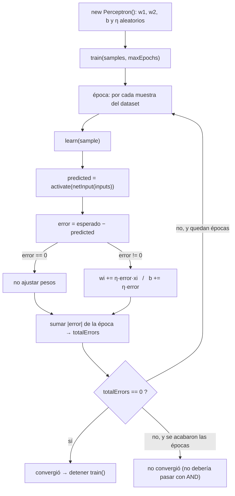
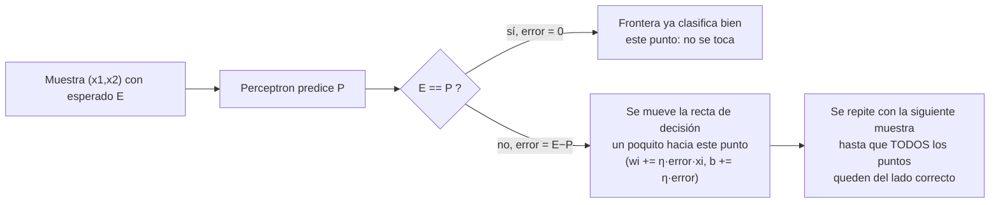

# Perceptrón Simple — Compuerta AND

Aplicación web (HTML + CSS + JavaScript orientado a objetos, sin frameworks ni librerías externas) que simula una neurona artificial mediante el algoritmo del **Perceptrón Simple**, la entrena con la compuerta lógica **AND** y evalúa automáticamente con valores reales de entrada generados de forma **aleatoria** en cada ejecución (pesos, sesgo, tasa de aprendizaje, orden de entrenamiento y valores de evaluación).

## Cómo ejecutar

Los archivos usan ES Modules (`import`/`export`), por lo que el navegador exige servirlos por HTTP (no funciona con doble clic sobre `index.html` por restricciones CORS de `file://`).

```bash
cd ia_class
python3 -m http.server 8000
```

Luego abre en el navegador: **http://localhost:8000/index.html**

Cada clic en "Entrenar y evaluar de nuevo (aleatorio)" genera una neurona nueva (pesos/bias/tasa de aprendizaje aleatorios), reentrena y vuelve a evaluar con nuevos valores reales aleatorios.

---

## ¿Por qué esta estructura de carpetas? (Clean Architecture)

```
ia_class/
├── index.html
├── main.js                      # Composition root
├── css/styles.css
├── src/
│   ├── domain/                  # Capa 1 (más interna): reglas de negocio puras
│   │   ├── Sample.js
│   │   ├── Perceptron.js
│   │   └── EpochResult.js
│   ├── application/              # Capa 2: casos de uso, orquestan el dominio
│   │   ├── GenerateDatasetUseCase.js
│   │   ├── TrainPerceptronUseCase.js
│   │   └── EvaluatePerceptronUseCase.js
│   ├── infrastructure/           # Capa 3: detalles técnicos (Canvas, DOM)
│   │   ├── ChartRenderer.js
│   │   └── TableRenderer.js
│   └── presentation/              # Capa 4 (más externa): conecta todo con la UI
│       └── AppController.js
```

La idea central de Clean Architecture es la **regla de dependencia**: las capas de afuera pueden conocer a las de adentro, pero nunca al revés.

- `domain` no importa nada de `application`, `infrastructure` ni `presentation`. `Perceptron` no sabe que existe un `<canvas>` ni un botón HTML — solo sabe matemáticas y reglas del algoritmo.
- `application` importa clases de `domain` para orquestarlas, pero no toca el DOM directamente.
- `infrastructure` sabe dibujar en pantalla (Canvas, tablas HTML), pero no sabe nada de la lógica del perceptrón — solo recibe datos ya calculados.
- `presentation` (`AppController`) es la única pieza que conoce el DOM real (botones, inputs) y es quien conecta las tres capas anteriores.

**Ventaja práctica**: se podría cambiar toda la interfaz gráfica (por ejemplo a React, o a una app de consola) reescribiendo solo `infrastructure`/`presentation`, sin tocar ni una línea de `domain` — porque ahí vive el algoritmo real del perceptrón, que es independiente de cómo se muestre.

---

## Cómo se aplica la Programación Orientada a Objetos (POO)

Todo el proyecto está modelado como **clases de JavaScript (ES6+)** con los 4 pilares clásicos de POO:

| Pilar | Dónde se aplica |
|---|---|
| **Encapsulamiento** | Métodos privados con `#` (ej. `#shuffle`, `#applyNoise`, `#renderPaginated`) — son detalles internos de cada clase, invisibles y no invocables desde afuera. |
| **Abstracción** | Cada clase expone una API mínima y clara (`perceptron.predict(inputs)`, `useCase.execute()`) que oculta la complejidad interna (cálculo de `netInput`, barajado Fisher-Yates, dibujo pixel a pixel). |
| **Responsabilidad única** | Cada clase hace una sola cosa: `Sample` solo representa un dato, `Perceptron` solo sabe aprender/predecir, `TableRenderer` solo sabe dibujar tablas. |
| **Composición sobre herencia** | No hay jerarquías de herencia (no había necesidad real): las clases se **componen** entre sí — `AppController` *tiene* un `TableRenderer`, un `ChartRenderer` y un `TrainPerceptronUseCase` como colaboradores inyectados en su constructor. |

No se usó herencia de clases (`extends`) porque ninguna clase es "un tipo especial de otra" — todas son conceptos distintos que colaboran, no variantes de una misma entidad. Por eso se prefirió composición e inyección de dependencias vía constructor (ver `AppController`, `TrainPerceptronUseCase`).

---

## Archivo por archivo, método por método

### `main.js` — Composition root

Único lugar donde se "arma" la aplicación: obtiene las referencias del DOM real y las inyecta en `AppController`.

- Espera el evento `DOMContentLoaded` (para asegurarse de que el HTML ya existe).
- Crea **una sola instancia** de `AppController`, pasándole los elementos del DOM por medio de un objeto (inyección de dependencias).
- Llama `app.run()` para que la app haga un primer entrenamiento automático al cargar la página (sin que el usuario tenga que hacer clic).

---

### `src/domain/Sample.js` — Entidad de dominio

Representa **un dato de entrenamiento/evaluación**: dos entradas (`x1`, `x2`) y la salida esperada.

- **`constructor(x1, x2, expected)`**: guarda los tres valores como propiedades del objeto.
- **`toInputs()`**: devuelve `[x1, x2]` como arreglo, formato que espera `Perceptron.predict()`. Existe para no repetir `[sample.x1, sample.x2]` en cada lugar que necesita las entradas — es la única forma "correcta" de extraerlas.

Es la unidad de información más pequeña del dominio: no tiene ninguna lógica de aprendizaje, solo transporta datos.

---

### `src/domain/EpochResult.js` — Objeto de valor

Representa **la fotografía de una época completa de entrenamiento**: qué pesos, bias y errores tuvo la neurona al terminar de procesar todas las muestras una vez.

- **`constructor(epochNumber, weights, bias, totalErrors, details)`**: copia los pesos con `[...weights]` (no guarda la referencia original) para que cada época quede "congelada" con sus propios valores — si no se copiara, todas las épocas del historial terminarían apuntando al mismo arreglo de pesos (el último), porque `Perceptron.weights` se sigue mutando después.

Esta clase es la que le da al proyecto su tabla histórica y su gráfico de convergencia: sin ella, solo tendríamos el estado *final* de la neurona, no su evolución.

---

### `src/domain/Perceptron.js` — La neurona artificial (el corazón del dominio)

Implementa el algoritmo del **Perceptrón Simple**:

```
y = f(w1·x1 + w2·x2 + b)
f(z) = 1 si z ≥ 0, 0 si z < 0        (función escalón)
wi = wi + η·(esperado − obtenido)·xi  (regla de aprendizaje)
b  = b  + η·(esperado − obtenido)
```

- **`constructor(numInputs = 2, learningRate = null)`**: crea la neurona con pesos (`weights`), sesgo (`bias`) y tasa de aprendizaje (`learningRate`) **generados aleatoriamente** llamando a los métodos estáticos de abajo. Si no se pasa `learningRate`, se sortea uno entre 0.1 y 0.5. Esto es justamente lo que garantiza que "nada sea fijo": cada `new Perceptron()` es una neurona distinta.
- **`static randomInRange(min, max)`**: utilidad matemática pura — un número aleatorio dentro de un rango. Es `static` porque no depende del estado de ninguna instancia particular, es una función de ayuda de la clase en general.
- **`static randomVector(size, min, max)`**: genera un arreglo de `size` números aleatorios (se usa para los pesos iniciales `w1, w2`).
- **`activate(z)`**: la función de activación escalón. Si el estímulo `z` es ≥ 0 la neurona "se activa" (devuelve 1), si no, devuelve 0.
- **`netInput(inputs)`**: calcula la suma ponderada `w1·x1 + w2·x2 + b` usando `reduce()`. Es el "estímulo" que entra a la función de activación.
- **`predict(inputs)`**: combina `netInput` + `activate` — es la salida final de la neurona para unas entradas dadas. Este es el método que representa "usar" la neurona ya entrenada.
- **`learn(sample)`**: un **paso de aprendizaje** con una sola muestra:
  1. Predice con el estado actual de pesos.
  2. Calcula el error = esperado − obtenido.
  3. Si hay error, ajusta cada peso proporcional a `learningRate × error × entrada`, y el bias proporcional a `learningRate × error`.
  4. Devuelve un objeto con el detalle del paso (para poblar la tabla de entrenamiento en pantalla).
- **`train(samples, maxEpochs = 100)`**: el bucle de entrenamiento completo.
  - En cada **época**, llama `learn()` una vez por cada muestra del dataset (`samples.map(...)`).
  - Suma los errores absolutos de la época (`totalErrors`).
  - Guarda un `EpochResult` con el estado de esa época en `history`.
  - **Corta el bucle apenas `totalErrors === 0`** (la neurona ya no comete errores en ninguna muestra) — ese es el número de "iteraciones" (épocas) que se muestra en el resumen de la interfaz.
  - Si nunca converge, se detiene al llegar a `maxEpochs` (protección contra bucles infinitos).
- **`clone()`**: crea una copia independiente de la neurona (mismos pesos/bias, pero arreglo de pesos distinto en memoria). No se usa actualmente en el flujo principal, pero existe como utilidad de dominio por si se quisiera comparar el estado "antes/después" de un entrenamiento sin mutar el original.

---

### `src/application/GenerateDatasetUseCase.js` — Caso de uso: generar el dataset AND

- **`execute()`**: construye las 4 combinaciones fijas de la tabla de verdad AND (`(0,0)→0`, `(0,1)→0`, `(1,0)→0`, `(1,1)→1`) como instancias de `Sample`, y devuelve el resultado de barajarlas.
- **`#shuffle(array)`**: algoritmo de **Fisher-Yates** para desordenar el arreglo de forma aleatoria y uniforme. Se usa para que el *orden* en que la neurona ve las muestras cambie en cada entrenamiento — la tabla de verdad del AND no puede cambiar (es una definición lógica), pero el orden de presentación sí, y eso es lo que se aleatoriza aquí.

---

### `src/application/TrainPerceptronUseCase.js` — Caso de uso: entrenar

Orquesta la creación y el entrenamiento completo de una neurona nueva.

- **`constructor(generateDatasetUseCase, maxEpochs = 100)`**: recibe por **inyección de dependencias** el caso de uso que genera el dataset (en vez de crearlo internamente) — esto hace la clase más fácil de probar y de reemplazar (por ejemplo, se le podría inyectar un generador de dataset distinto sin tocar esta clase).
- **`execute()`**:
  1. Pide el dataset (ya barajado) al `generateDatasetUseCase`.
  2. Crea una neurona nueva: `new Perceptron(2)` (2 entradas, pesos/bias/tasa aleatorios).
  3. La entrena con `perceptron.train(dataset, maxEpochs)`.
  4. Determina si convergió mirando si la última época del historial tiene `totalErrors === 0`.
  5. Devuelve todo lo que la UI necesita: la neurona entrenada, el dataset usado, el historial completo y el número de épocas que tardó en converger.

---

### `src/application/EvaluatePerceptronUseCase.js` — Caso de uso: evaluar con valores reales

Genera automáticamente entradas **reales** (no solo 0/1 exactos) para poner a prueba la generalización de la neurona ya entrenada.

- **`constructor(sampleCount = null, noise = null)`**: si no se especifican, **ambos se sortean solos** — `sampleCount` entre 6 y 15 muestras, `noise` entre 0.1 y 0.4. Así, ni siquiera la cantidad de evaluaciones la decide una persona: la decide el propio caso de uso en cada ejecución.
- **`execute(perceptron)`**: por cada muestra a generar:
  1. Sortea un bit esperado para cada entrada (0 o 1).
  2. Le agrega ruido con `#applyNoise` para simular una lectura real (ej. `0.92` en vez de `1`).
  3. Calcula la etiqueta esperada aplicando la tabla lógica AND sobre los bits originales (antes del ruido).
  4. Le pide a la neurona (`perceptron.predict(...)`) que prediga con la entrada ruidosa.
  5. Devuelve un registro con índice, entradas reales, esperado, predicho y si acertó o no.
- **`#applyNoise(bit)`**: le suma al bit un desplazamiento aleatorio proporcional a `noise`, y recorta el resultado al rango `[-0.5, 1.5]` para que los valores sigan siendo representativos de "cerca de 0" o "cerca de 1" sin desbordarse.

---

### `src/infrastructure/TableRenderer.js` — Construcción de tablas HTML con paginación

No conoce nada del algoritmo del perceptrón: solo sabe transformar arreglos de datos en elementos `<table>` del DOM.

- **`renderTrainingHistory(container, history, epochsPerPage = 4)`**: punto de entrada público para pintar la tabla de entrenamiento, paginada de a 4 épocas.
- **`renderEvaluation(container, results, rowsPerPage = 8)`**: punto de entrada público para pintar la tabla de evaluación, paginada de a 8 filas.
- **`#renderPaginated(container, items, pageSize, buildTableFn)`**: método privado genérico y reutilizable que implementa la paginación en sí:
  - Calcula `totalPages` a partir de la cantidad de datos y el tamaño de página.
  - Mantiene `currentPage` en una variable local (closure) y una función interna `renderPage()` que recorta el arreglo (`slice`) al tramo correspondiente, construye la tabla con la función que le pasaron (`buildTableFn`) y, si hay más de una página, agrega los controles de paginación.
  - Al hacer clic en "Siguiente"/"Anterior", solo cambia `currentPage` y vuelve a llamar `renderPage()` — no reconsulta datos, todo el historial ya está en memoria.
- **`#buildPagination(currentPage, totalPages, onChange)`**: crea los botones "‹ Anterior" / "Siguiente ›" y el texto "Página X de Y". `onChange` es un *callback* que le entrega el control de qué hacer cuando cambia de página al método que lo llamó — patrón de inversión de control.
- **`#buildTrainingTable(epochResults)`**: arma la tabla de entrenamiento para una porción (página) de épocas — una fila por cada muestra procesada dentro de cada época, mostrando el número de época y el total de errores solo en la primera fila del grupo (para no repetir visualmente).
- **`#buildEvaluationTable(results)`**: arma la tabla de evaluación para una porción de resultados, marcando con clases CSS (`row-success` / `row-error`) si la predicción fue correcta.
- **`#buildHeader(labels)`**: utilidad compartida para no repetir la construcción del `<thead>` en los dos métodos anteriores.

---

### `src/infrastructure/ChartRenderer.js` — Dibujo en `<canvas>`

Tampoco conoce el algoritmo del perceptrón: recibe puntos y pesos ya calculados, y solo sabe convertirlos en píxeles.

- **`PALETTE`** (constante del módulo): centraliza los colores usados en los gráficos, para mantener consistencia visual y poder cambiar el estilo en un solo lugar.
- **`constructor(canvas)`**: guarda la referencia al `<canvas>` y obtiene su contexto de dibujo 2D (`getContext('2d')`).
- **`#clear()`**: limpia todo el lienzo antes de redibujar (se llama al inicio de cada render, para que los gráficos no se acumulen entre ejecuciones).
- **`#toPixel(x, y, min, max)`**: convierte una coordenada matemática (ej. `x1=1, x2=1`) en una coordenada de píxel dentro del canvas, respetando el `padding` y el rango de valores a mostrar. Es la función puente entre "el mundo del problema" y "el mundo de los píxeles".
- **`#drawAxes(min, max)`**: dibuja los ejes x1/x2, sus marcas numéricas y etiquetas.
- **`renderDecisionBoundary(points, perceptron)`**: dibuja el plano x1/x2 completo:
  1. Limpia y dibuja los ejes.
  2. Calcula la recta de decisión despejando `x2` de `w1·x1 + w2·x2 + b = 0` en los dos extremos del rango visible, y la traza.
  3. Dibuja cada punto (dataset de entrenamiento + evaluación) como un círculo verde (clase esperada 1) o rojo (clase esperada 0).
- **`renderConvergence(history)`**: dibuja el gráfico de errores por época:
  1. Calcula los ejes según la cantidad de épocas (`maxEpoch`) y el error máximo alcanzado (`maxError`).
  2. Traza una línea conectando el total de errores de cada época.
  3. Pinta en verde el punto de la época donde ya no hay errores (convergencia).

---

### `src/presentation/AppController.js` — El controlador (única clase que toca el DOM)

Es el **punto de composición de la UI**: recibe los elementos del DOM y arma/coordina todas las piezas anteriores.

- **`constructor({...})`**: recibe por *destructuring* todos los elementos del DOM que necesita (inyección de dependencias, igual que en `main.js`). Aquí:
  - Instancia sus colaboradores internos: `TableRenderer`, dos `ChartRenderer` (uno para cada canvas) y `TrainPerceptronUseCase` (al que a su vez le inyecta un `GenerateDatasetUseCase` nuevo).
  - Registra el listener de clic del botón, que llama a `this.run()`.
- **`run()`**: el flujo completo de una "ejecución":
  1. Ejecuta `trainUseCase.execute()` → obtiene neurona entrenada, dataset, historial y si convergió.
  2. Crea un `EvaluatePerceptronUseCase()` (sin argumentos → cantidad y ruido aleatorios) y lo ejecuta sobre la neurona recién entrenada.
  3. Llama a `#renderSummary` para las tarjetas de resumen.
  4. Le pide a `tableRenderer` que pinte ambas tablas (con su paginación).
  5. Le pide a los dos `ChartRenderer` que dibujen el plano de decisión y la curva de convergencia.
- **`#renderSummary(perceptron, converged, epochsToConverge, evaluationResults)`**: arma el HTML de las tarjetas de resumen (estado, épocas hasta converger, tasa de aprendizaje, pesos/bias finales, precisión y cantidad de evaluaciones generadas), calculando primero la precisión (`correctCount / total`).

---

## Resumen del flujo completo

1. `main.js` crea el `AppController` y llama `run()`.
2. `AppController` pide a `TrainPerceptronUseCase` que entrene una neurona nueva.
3. `TrainPerceptronUseCase` pide a `GenerateDatasetUseCase` la tabla AND barajada, crea un `Perceptron` (pesos/bias/tasa aleatorios) y lo entrena llamando a `perceptron.train(...)`, que internamente llama `learn(...)` muestra por muestra hasta converger.
4. `AppController` pide a `EvaluatePerceptronUseCase` que genere entradas reales aleatorias y las evalúe contra la neurona ya entrenada.
5. `AppController` delega el pintado a `TableRenderer` (tablas paginadas) y `ChartRenderer` (gráficos en canvas), sin que ninguno de los dos sepa cómo funciona el perceptrón por dentro.

---

## ¿Cómo sé que el algoritmo del perceptrón quedó correctamente implementado?

No es "porque compila" ni "porque no tira error" — la forma correcta de verificarlo es comparar el **código** contra la **teoría matemática** del Perceptrón Simple (Rosenblatt, 1958) punto por punto, y después comprobar que el **comportamiento observable** coincide con lo que esa teoría promete. Se cumplen las tres cosas:

### 1) Las fórmulas del código son exactamente las de la teoría

| Concepto teórico | Fórmula | Línea en `Perceptron.js` |
|---|---|---|
| Entrada neta (combinación lineal) | `z = w1·x1 + w2·x2 + b` | `netInput()` (línea 24), con `reduce` |
| Función de activación escalón | `f(z) = 1 si z≥0, 0 si z<0` | `activate()` (línea 20) |
| Predicción | `y = f(z)` | `predict()` (línea 28) |
| Regla de aprendizaje del perceptrón | `wi ← wi + η·(esperado−obtenido)·xi` | `learn()` (línea 38) |
| Ajuste del sesgo | `b ← b + η·(esperado−obtenido)` | `learn()` (línea 40) |

Esa correspondencia 1 a 1 es la primera prueba: no hay una fórmula "inventada", cada línea de `Perceptron.js` es la traducción directa de una ecuación conocida y publicada del algoritmo original.

### 2) AND es "linealmente separable" → hay una garantía matemática de que el perceptrón *debe* converger

El **Teorema de Convergencia del Perceptrón** dice: si existe una línea recta (en 2D) que separa perfectamente los puntos de clase `1` de los de clase `0`, entonces el algoritmo de aprendizaje del perceptrón **encuentra esa línea en un número finito de épocas**, sin importar con qué pesos aleatorios arranque.

La compuerta AND cumple esa condición — se puede separar con una sola recta:

```
x2
 1 │  0        1
   │ (0,1)   (1,1)  ← única muestra positiva
   │
   │        ／  ← recta de decisión: w1·x1 + w2·x2 + b = 0
   │      ／
   │    ／
 0 │  0  ／     0
   │(0,0)      (1,0)
   └──────────────── x1
      0          1
```

Como esa recta existe, **es matemáticamente imposible que el algoritmo, bien implementado, no converja** para AND. Por eso `train()` puede parar apenas `totalErrors === 0` (línea 61-63): la teoría garantiza que ese momento va a llegar. Si el código estuviera mal (por ejemplo, con el signo de la regla de aprendizaje invertido), el entrenamiento **nunca convergería** y siempre llegaría al tope `maxEpochs` sin bajar los errores a cero — eso es justo lo que la variable `converged` (en `TrainPerceptronUseCase.js`) permite detectar.

### 3) El comportamiento observado confirma la teoría (evidencia empírica)

Corriendo la app repetidas veces (pesos, bias y orden de muestras distintos cada vez) se puede verificar:

- ✅ **Siempre converge** (`converged = true`) en pocas épocas (típicamente entre 2 y ~15), nunca llega a `maxEpochs = 100` sin resolverlo — tal como predice el teorema.
- ✅ Al final del entrenamiento, la neurona **predice perfecto sobre las 4 combinaciones exactas** de la tabla AND (0 errores en la última época).
- ✅ En la evaluación con **ruido** (`EvaluatePerceptronUseCase`), valores cercanos a 0/1 (ej. `x1=0.92, x2=1.08`) se siguen clasificando bien la mayoría de las veces — señal de que la neurona no "memorizó" 4 puntos exactos, sino que aprendió una **frontera de decisión** (una recta) con margen alrededor de esos puntos.
- ✅ La recta que dibuja `ChartRenderer.renderDecisionBoundary()` (despejando `x2` de `w1·x1+w2·x2+b=0`) efectivamente separa visualmente los puntos verdes (clase 1) de los rojos (clase 0) en el canvas — esto es literalmente **ver** la solución que el teorema promete.

### Diagrama de flujo del algoritmo completo



### Diagrama de por qué el ajuste de pesos "empuja" la recta hacia la separación correcta



En resumen: la validación de que el algoritmo "quedó bien implementado" no es una sola prueba, sino la combinación de que **(a)** cada fórmula del código coincide con la teoría publicada del perceptrón, **(b)** esa teoría garantiza convergencia para un problema linealmente separable como AND, y **(c)** ejecutar la app una y otra vez con valores aleatorios distintos siempre reproduce exactamente ese comportamiento esperado (converge rápido, clasifica bien la tabla exacta, generaliza razonablemente con ruido, y la recta dibujada separa visualmente las clases).
